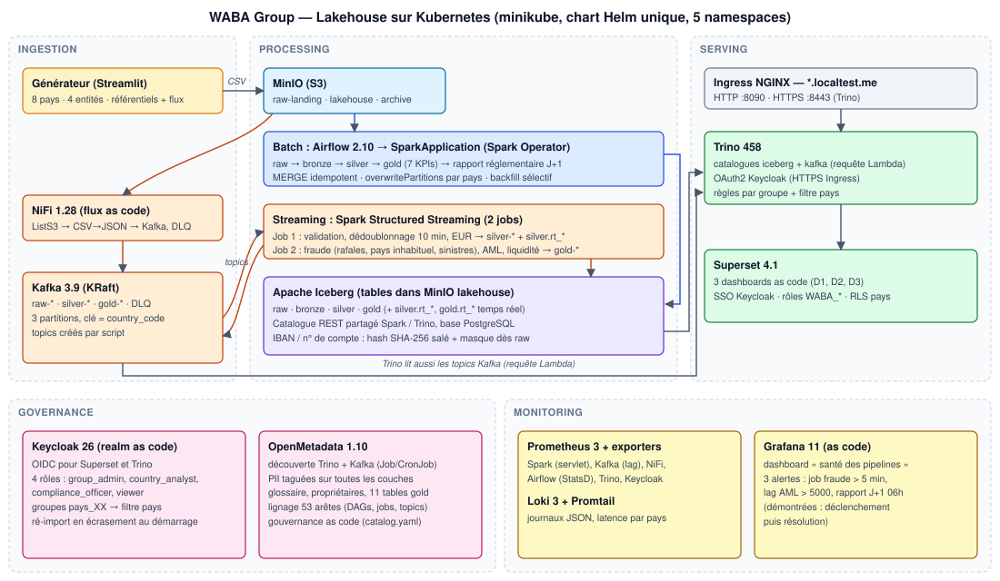

# WABA Group — Plateforme analytique financière multi-pays

Challenge Data Engineer Artefact : un Data Lakehouse batch + streaming pour un groupe fictif de banque-assurance
(banque, assurance, mobile money, microfinance) présent dans 8 pays d'Afrique de l'Ouest (7 en zone UEMOA + Ghana).

> **Avancement** : niveaux 1, 2, 3 et 4 réalisés et validés.
> **Write-up technique** : [docs/WRITEUP.md](docs/WRITEUP.md) ([PDF](docs/WRITEUP.pdf)) ·
> **Journal des décisions** (34 décisions, problèmes rencontrés) : [docs/DECISIONS.md](docs/DECISIONS.md)



| Niveau | Contenu | Environnement |
|---|---|---|
| 1 | Générateur Streamlit, MinIO, ingestion Spark → Iceberg (`raw`), Trino | Docker Compose |
| 2 | Airflow, médaillon `bronze` → `silver` → `gold` (7 KPIs), rapport réglementaire J+1, backfill par pays | Docker Compose |
| 3 | NiFi → Kafka → Spark Structured Streaming (fraude, AML, liquidité), requête Lambda Trino | Docker Compose |
| 4 | Kubernetes (Helm), Spark Operator, Superset, Keycloak (SSO + 4 rôles), OpenMetadata, Prometheus / Loki / Grafana | minikube |

---

## 1. Prérequis

Versions utilisées pour la validation (Windows 11 + WSL2) :

| Outil | Version testée | Remarque |
|---|---|---|
| WSL2 | Ubuntu 24.04 | cloner le dépôt **dans WSL** (`~/`), pas dans `/mnt/c` (très lent) |
| Docker Engine | 29.2 (Compose v2) | |
| minikube | 1.39 | pilote `docker` |
| kubectl | 1.37 | |
| Helm | 3.22 | |
| Python | 3.12 (+ `python3-venv`) | scripts `make env`, `make k8s-trino-sso` |
| make, git | récents | |

**Ressources** : 8 cœurs et 24 Go de mémoire pour WSL ; minikube reçoit toute cette capacité (validé : nœud à
8 CPU / 23,5 Gio, environ 18 Go réellement utilisés au niveau 4). Fichier
`%UserProfile%\.wslconfig` côté Windows, puis `wsl --shutdown` :

```ini
[wsl2]
memory=24GB
processors=8
```

**Accès Internet** : images Docker Hub, quay.io (Keycloak), docker.getcollate.io (OpenMetadata), docker.elastic.co,
et le dépôt Helm de Spark Operator (première installation uniquement).

## 2. Variables d'environnement et secrets

Aucun secret n'est versionné. [`.env.example`](.env.example) liste **toutes** les variables avec des valeurs
d'exemple (`change-me-...`) et un commentaire pour chacune.

```bash
make env     # crée .env à partir de .env.example ; chaque « change-me » devient un secret aléatoire
             # relancé plus tard, il ajoute seulement les variables manquantes (valeurs existantes conservées)
```

Pour Kubernetes, `make k8s-secrets` (appelé par `make k8s-install`) génère `helm/values-secrets.yaml` (droits 600,
ignoré par git) : le chart en fait un Secret `waba-secrets` par namespace, limité aux clés utiles.

---

## 3. Déploiement Kubernetes (niveau 4) — du clone aux premières requêtes Trino

### 3.1 Cluster

```bash
git clone https://github.com/mkindo19/waba-lakehouse.git && cd waba-lakehouse
make env

minikube start --driver=docker --cpus=max --memory=max --force   # toute la capacité de WSL ; --force : root sous WSL
minikube addons enable ingress
minikube addons enable metrics-server
kubectl get nodes                       # minikube   Ready
```

Après un redémarrage de WSL ou du poste : `make k8s-start`.

### 3.2 Images et installation

```bash
make k8s-images      # construit les 5 images maison (générateur, Spark, Airflow, Superset, synchro OpenMetadata)
                     # et les charge dans minikube (~5 à 10 min la première fois)
make k8s-lint        # optionnel : helm lint + rendu complet du chart, sans rien installer
make k8s-install     # un seul « helm upgrade --install » : toute la plateforme (~10 à 15 min la première fois)
make k8s-status      # pods, volumes, URL
```

`make k8s-install` enchaîne : copie des scripts dans le chart (`k8s-files`), génération des secrets
(`k8s-secrets`), CRD de Spark Operator (`k8s-crds`), puis l'installation. Il est **idempotent** : on le relance
après toute modification (code, DAG, dashboard, realm Keycloak...).

> Au premier démarrage, le job streaming « fraude / AML » redémarre en boucle tant que les référentiels
> `silver.customers` / `silver.accounts` n'existent pas : c'est attendu, il démarre seul après l'étape 3.4.

### 3.3 Accès aux interfaces

Dans un **terminal dédié** (à laisser tourner) :

```bash
make k8s-expose      # port-forward de l'Ingress : http://<nom>.localtest.me:8090 et https://trino.localtest.me:8443
```

`*.localtest.me` est un DNS public qui répond 127.0.0.1 : rien à modifier dans le fichier hosts.

| Interface | URL | Connexion |
|---|---|---|
| Générateur (Streamlit) | http://generator.localtest.me:8090 | — |
| MinIO | http://minio.localtest.me:8090 | `MINIO_ROOT_USER` / `MINIO_ROOT_PASSWORD` |
| NiFi | http://nifi.localtest.me:8090/nifi | — |
| Kafka UI | http://kafka-ui.localtest.me:8090 | — |
| Airflow | http://airflow.localtest.me:8090 | `AIRFLOW_ADMIN_USER` / `AIRFLOW_ADMIN_PASSWORD` |
| **Superset** | http://superset.localtest.me:8090 | bouton **keycloak** (comptes ci-dessous) |
| **Trino** | https://trino.localtest.me:8443/ui/ | Keycloak (certificat auto-signé : « Continuer ») |
| Grafana | http://grafana.localtest.me:8090 | `GRAFANA_ADMIN_USER` / `GRAFANA_ADMIN_PASSWORD` |
| Prometheus | http://prometheus.localtest.me:8090 | — |
| OpenMetadata | http://openmetadata.localtest.me:8090 | `admin@open-metadata.org` / `OPENMETADATA_ADMIN_PASSWORD` |
| Keycloak (console) | http://keycloak.localtest.me:8090/admin | `admin` / `KEYCLOAK_ADMIN_PASSWORD` |

Les valeurs se lisent dans `.env` (`grep NOM_VARIABLE .env`).

**Comptes de démonstration Keycloak** (mot de passe commun `KEYCLOAK_DEMO_PASSWORD`, rappel : `make k8s-sso`) :

| Utilisateur | Rôle | Superset | Trino |
|---|---|---|---|
| `admin.groupe` | group_admin | tout, SQL Lab | tous catalogues |
| `analyste.ci` / `analyste.sn` | country_analyst | 3 dashboards, **son pays uniquement** | silver + gold filtrés sur son pays |
| `conformite` | compliance_officer | D2 Risque & Conformité | 9 tables gold réglementaires |
| `lecteur` | viewer | D1 et D3 en lecture seule | 7 tables gold agrégées, aucune donnée sensible |

Pour changer de compte : fermer **toutes** les fenêtres privées (sinon la session Keycloak reconnecte le même
utilisateur).

### 3.4 Données et pipelines

```bash
make k8s-referentials    # référentiels : 500 000 clients, 800 000 comptes, agences, produits (~1 min)
make k8s-generate        # un trimestre de transactions, 8 pays, 4 flux, dans MinIO raw-landing
make k8s-dags-on         # active la chaîne batch : ingest_raw (toutes les 10 min) -> bronze/silver -> gold
make k8s-dag DAG=dag_ingest_raw          # déclenchement immédiat (sinon au prochain passage)
make k8s-dag-runs        # suivi : runs des DAGs et SparkApplication (chaîne complète ~20 à 30 min)
make k8s-dag DAG=dag_regulatory_report   # rapport réglementaire BCEAO / CIMA de J-1
```

Backfill d'un seul pays : dans Airflow, *Trigger DAG w/ config* → `{"country_code": "SN"}`.

Temps réel (NiFi → Kafka → 2 jobs Spark Streaming, déployés et démarrés par l'installation) :

```bash
make k8s-stream ROWS=2000 DURATION=300   # flux continu de transactions pendant 5 min
make k8s-alert-test COUNTRY=SN           # rafale de retraits + AML + liquidité, horodatées maintenant
make k8s-gold-peek                       # messages dans gold-fraud-alerts / gold-aml-events / gold-liquidity-alerts
make k8s-lag                             # retard des jobs Spark (groupes de supervision waba-spark.*)
make k8s-spark                           # état des applications Spark ; journaux : make k8s-spark-logs APP=stream-fraud-aml
```

### 3.5 Premières requêtes Trino

Compte de service (dans le cluster, sans Keycloak) :

```bash
make k8s-trino
```
```sql
SHOW SCHEMAS;                                            -- raw, bronze, silver, gold
SELECT country_code, period_month, round(npl_ratio * 100, 2) AS npl_pct
FROM gold.npl_ratio_by_country WHERE loan_type = 'ALL' ORDER BY 1, 2;
SELECT country_code, count(*) AS alertes FROM gold.rt_fraud_alerts GROUP BY 1;
```

Requêtes de contrôle par niveau : [`sql/`](sql) (par exemple `sql/level3_lambda.sql`, la requête Lambda qui unit
Iceberg et Kafka).

Avec un compte Keycloak (vérifie les droits par rôle) :

```bash
make k8s-trino-sso       # affiche une URL : l'ouvrir dans une fenêtre privée et se connecter (ex. analyste.ci)
```
```
[OK]      Identité vue par Trino : analyste.ci ['pays_CI', 'analystes_pays']
[OK]      Silver : transactions par pays (filtre pays) : CI 26614
[REFUSÉ]  Catalogue Kafka (topics bruts) : accès refusé
```

### 3.6 Gouvernance et observabilité

- **OpenMetadata** : la découverte (tables Trino, topics Kafka) et la gouvernance as code
  ([governance/catalog.yaml](governance/catalog.yaml) : équipes, glossaire, tags PII et réglementaires, lignage)
  sont appliquées à chaque `make k8s-install` et chaque nuit ; à la demande : `make k8s-om-sync`.
- **Grafana** : dashboard « santé des pipelines » et 3 alertes (job fraude en erreur > 5 min, retard AML > 5000,
  rapport réglementaire absent à 06h00 UTC). Démonstration :
  ```bash
  make k8s-demo-break                       # casse le job fraude -> alerte « job en erreur » après 5 min
  make k8s-stream ROWS=3000 DURATION=600    # le retard AML dépasse 5000 -> 2e alerte
  make k8s-demo-repair                      # rétablit le job : retard rattrapé, alertes résolues
  ```

### 3.7 Arrêt et désinstallation

```bash
minikube stop            # arrêt (tout est conservé) ; reprise : make k8s-start puis make k8s-expose
make k8s-uninstall       # désinstalle la plateforme ; les volumes de données sont conservés (PVC « keep »)
```

---

## 4. Docker Compose (niveaux 1 à 3)

Environnement plus léger, utilisé pour développer les niveaux 1 à 3. Ne pas le faire tourner en même temps que
minikube (mémoire).

```bash
make env && make up                 # stack batch : MinIO, catalogue Iceberg, Spark, Trino, Airflow, générateur
make referentials && make generate  # données (ou http://localhost:8501)
make ingest                         # raw-landing -> raw.* (niveau 1) ; make bronze / silver / gold (niveau 2)
make trino                          # client SQL ; contrôles : sql/level1_checks.sql, sql/level2_checks.sql
make up-streaming && make nifi-deploy   # niveau 3 : Kafka, NiFi, jobs streaming
make alert-test && make lambda && make check3
```

| Service | URL locale |
|---|---|
| Générateur | http://localhost:8501 |
| MinIO | http://localhost:9001 |
| Airflow | http://localhost:8082 |
| Kafka UI | http://localhost:8085 |
| NiFi | http://localhost:8089/nifi |
| Trino | http://localhost:8088 |

`make help` liste toutes les commandes (celles du niveau 4 sont préfixées `[N4]`).

---

## 5. Dépannage

| Symptôme | Cause | Solution |
|---|---|---|
| `ErrImageNeverPull` | image maison non chargée dans minikube | `make k8s-images` |
| Pod `Pending` (CPU insuffisant) | réservations CPU du nœud | `kubectl describe node minikube` ; arrêter une SparkApplication terminée (`make k8s-spark`) |
| Superset : « Invalid parameter: redirect_uri » | interface ouverte sur un autre port que 8090 | passer par `make k8s-expose` (port 8090) |
| Trino : page « authentication disabled » | ouverture en HTTP | utiliser **https**://trino.localtest.me:**8443** |
| Keycloak reconnecte toujours le même utilisateur | session SSO du navigateur | fermer toutes les fenêtres privées |
| `make k8s-trino-sso` : « ensurepip is not available » | module venv absent | `apt install -y python3.12-venv` puis relancer |
| Un DAG suivant reste `queued` | DAG en pause | `make k8s-dags-on` |
| Volumes Docker vides ou périmés (Compose sous WSL) | montage non rafraîchi | `docker compose up -d --force-recreate <service>` |

Autres cas vécus et leur analyse : [docs/DECISIONS.md](docs/DECISIONS.md).

---

## 6. Structure du dépôt

```
generator/            Application Streamlit + package waba_gen (référentiels, flux, dépôt MinIO) + tests
spark/                Image Spark (Iceberg, S3, Kafka) et jobs PySpark
  jobs/                 ingest_raw, raw_to_bronze, bronze_to_silver, silver_to_gold, regulatory_report,
                        stream_raw_to_silver, stream_fraud_aml
  jobs/common/          schémas, qualité, pseudonymisation, transformations (fonctions pures testées), supervision
  tests/                tests unitaires (pytest)
airflow/dags/         4 DAGs + opérateur SparkApplication (Kubernetes) / SparkSubmit (Compose)
infra/                Initialisation MinIO, topics Kafka, flux NiFi (as code), migration du catalogue Iceberg
trino/                Catalogues, description des topics Kafka, règles d'accès (security/rules.json)
superset/             Image, configuration (SSO Keycloak), dashboards et rôles as code
keycloak/             Realm « waba » as code (gen_realm.py -> waba-realm.json)
governance/           Synchronisation OpenMetadata et gouvernance as code (catalog.yaml)
monitoring/           Prometheus, Loki, Promtail, StatsD, Grafana (dashboard et alertes as code)
helm/waba-platform/   Chart Helm unique (5 namespaces) ; values-secrets.yaml généré, ignoré par git
scripts/              Génération de .env et des secrets Helm, démonstration SSO Trino
sql/                  Requêtes de contrôle par niveau
docs/                 Write-up, journal des décisions, schéma d'architecture
```

## 7. Qualité et sécurité

- Aucun secret dans le dépôt : `.env` et `helm/values-secrets.yaml` sont générés et ignorés par git.
- IBAN et numéros de compte pseudonymisés (SHA-256 salé) et masqués dès la première écriture Iceberg.
- Lignes invalides conservées avec leur motif (`raw.rejected_records`, topic `dlq-financial-events`).
- Journaux JSON structurés dans les composants Python ; tests : `make test`, `make test-spark` ; style : `make lint`.
- SSO Keycloak et droits par rôle sur Superset et Trino ; PII taguées et lignage dans OpenMetadata.
